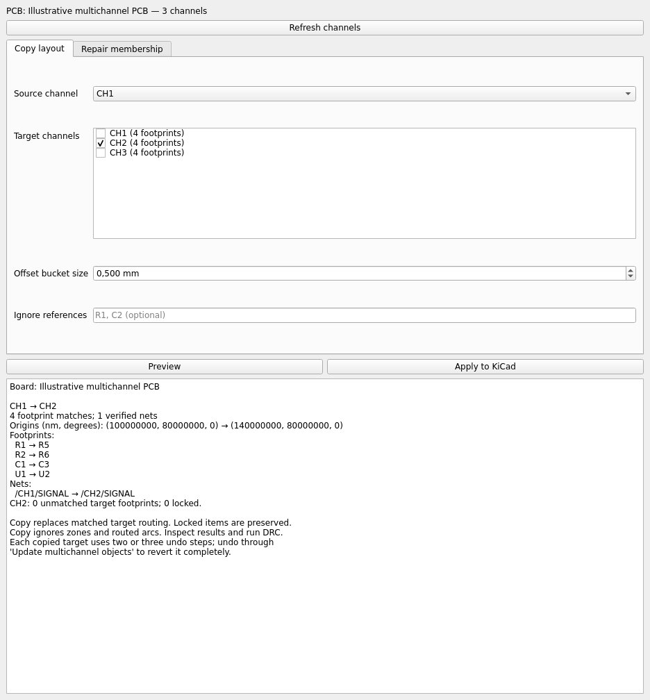

# KiCad Multichannel Layout

Native KiCad IPC plugin with a preview-first GUI for repeated PCB channels.

> **0.1.0 is a testing release.** Save a backup, inspect every result, and run DRC.
> The package targets KiCad 10+, Python 3.11+, and Linux, Windows, and macOS.
> Copy/apply was smoke-tested on KiCad 10.0.6 on Linux; PCM installation,
> undo, and Windows/macOS runtime still need manual validation.

## Install

### Subscribe in Plugin and Content Manager

In KiCad's project manager, open **Plugin and Content Manager → Manage… → Add repository**:

```text
https://raw.githubusercontent.com/J-Kreisel/kicad-multichannel/pcm/repository.json
```

Refresh the repository and install **KiCad Multichannel Layout**. Restart PCB Editor.
KiCad installs KiPy and PySide6 into its isolated plugin Python environment;
dependency installation needs internet access on first load.

### Install from a release ZIP

Download `kicad-multichannel-<version>-kicad-pcm.zip` from
[GitHub Releases](https://github.com/J-Kreisel/kicad-multichannel/releases).
Choose **Plugin and Content Manager → Install from File…** and select the ZIP without extracting it.

## Graphical workflow

1. Open your PCB and enable KiCad's IPC API server in preferences if necessary.
2. Put each repeated channel's footprints in a uniquely named PCB group.
   Include the source tracks/vias you want copied in the source group.
   Footprints must be direct members of the channel group, not only nested groups.
3. Open **Multichannel Layout** from the PCB toolbar or **Tools → External Plugins**.
4. Select the source and check one or more different target channels.
5. Click **Preview** and review footprint/net matches, origins, and skipped footprints.
6. Click **Apply to KiCad** and confirm. Do not edit the board during preview/apply.
7. Inspect the PCB, run DRC, and save only when satisfied.

The **Repair membership** tab previews adding missing or removing unnecessary routing
memberships. It changes group ownership only, never copper geometry.

Changing settings invalidates the preview. Copy apply also verifies the serialized
footprints, tracks, vias, groups, and board identity against the preview.
Membership apply additionally checks its connectivity fingerprint.
IPC reads and commits are not a board-wide transaction: keep the board unchanged
while an operation runs. Targets are applied sequentially; earlier targets remain
applied if a later target fails.



The screenshot uses illustrative channel data, not a live-board validation result.

## Development and packaging

```sh
python -m venv .venv
source .venv/bin/activate
pip install -e '.[dev]'
pytest
python tools/build_kicad_plugin.py
```

On NixOS, use `nix develop` for Qt's host shared libraries. The plugin launcher
also adapts the autorouter's NixOS/X11 compatibility handling.
`kicad-multichannel-gui` starts the GUI; a standalone run needs the IPC environment
from KiCad. Normal installed-plugin launches receive it automatically.

The build produces a pure-Python PCM archive in `dist/`; no Rust compiler or Nix
is needed on users' machines. See [release instructions](docs/releasing.md).

Multichannel placement and routing copier plus routing membership repair tools.
`copy` matches footprints pairwise, copies their relative placement, and
replaces safely matched target routing. `add-membership` / `remove-membership`
fix which routing tracks and vias belong to a channel group.

## How it works

1. **Channel list** — the first named group is the source/main channel; all
   following groups are targets.
2. **Matching** — reject pairs below 95% pad-layout compatibility, then
   iteratively lock the least-ambiguous pair. Each pad whose net relationship
   agrees with already locked pairs contributes `+1 / pad count`; a
   contradiction contributes `-1 / pad count`, with the net score floored at
   zero. Placement is only a tiebreaker.
3. **Offset voting** — each matched pair votes for an offset bucket. The bucket
   with the most votes wins; ties are broken by picking the bucket whose
   average movement is closest to the overall mean movement.
4. **Plan update** — matching produces one KiCad-independent `UpdatePlan` per
   target. It contains the source/target channel names and origins plus pairs
   of matched footprint references and verified net names.
5. **Copy placement** — every matched target footprint is moved using the
   chosen translation and rotation.
6. **Replace routing** — the executor resolves current tracks and vias from the
   named groups. Existing target routing for verified nets is removed and
   replaced by transformed source routing.
7. **Validate groups** — before committing, the complete group UUID topology is
   reconciled and checked. KiCad does not allow groups as IPC item containers,
   so object changes are committed first and their UUID memberships are
   repaired in subsequent commits after the objects are stable board items.
   Incorrect parent memberships are committed as removals before target-group
   memberships are added, because KiCad enforces one parent group per item.

Before applying a plan, the executor invokes KiCad's
`common.Interactive.groupLeave` action enough times to exit any nested group
editing context. KiCad otherwise implicitly inserts updated items, including an
updated target group itself, into the group currently being edited.

Each applied channel therefore creates at least two KiCad undo steps, and three
when items first need to be detached from another group. If restoration fails,
undo until the `Update multichannel objects` step has been reverted.

Routing outside the target group is not removed. Zones and routed arcs are
ignored. Group membership is changed only for replaced and newly created
tracks/vias; footprints, rule areas, and all other group members are preserved.
Locked footprints are not moved. If a verified target net has any locked track
or via, that entire net is left untouched.

An update plan has this shape:

```python
UpdatePlan(
    source_channel="CH1",
    target_channel="CH2",
    source_origin=(120_000_000, 85_000_000, 0.0),
    target_origin=(160_000_000, 85_000_000, 0.0),
    footprint_matches=(("R1", "R28"), ("C1", "C15")),
    net_matches=(("/CH1/SIGNAL", "/CH2/SIGNAL"),),
)
```

The executor receives only this plan. It resolves group IDs, footprint IDs,
routing objects, and lock state from the live board immediately before the
update. Copy reads are fail-closed: malformed or disappearing footprints,
tracks, and vias abort the operation instead of producing a partial copy.

Origin calculation and offset bucketing are hidden behind the planner. Once it
has the channel snapshots, callers only provide two names:

```python
planner = UpdatePlanner(channels, bucket_size_nm=500_000)
source_origin, target_origin = planner.find_channel_origins("CH1", "CH2")
plan = planner.build_update_plan("CH1", "CH2")
```

Locked target footprints are authoritative origin anchors. With one anchor,
its source and target footprint poses become the two origins and other matches
do not participate in bucketing. Multiple locked anchors must describe exactly
the same rigid transform. Conflicting anchors, or a locked target footprint
without a source match, make planning fail before the board is modified.

## Routing membership repair

`add-membership` fixes a channel that was routed without entering the group:
routing that physically connects the group's pads exists, but is not a group
member. `remove-membership` is the inverse: the group contains routing that is
not needed for its own internal connectivity (for example routing that was
drawn while still inside the group, continuing across the board).

Both commands start with the same physical connectivity analysis:

1. Collect all pads of the group's footprints and their nets.
2. Build copper islands from tracks, vias, arcs, and pads. Islands are purely
   physical: a shared net name without a physical connection is not
   connectivity, and zones never connect anything. Empty/no-net pads and
   copper still participate through their physical contacts. Connectivity uses
   KiCad's layer-specific pad polygons, track/arc widths, via diameters, and
   tessellated routed-arc centerlines. NPTH pads never bridge copper layers.
3. Within a candidate island, all internal pads must stay mutually connected.
   Starting from the island's copper, each track/via is tentatively removed
   (deterministic order) and restored if that would disconnect internal pads
   from each other.

For `add-membership`, every island with at least two internal pads is a
candidate, including internal-only and no-net islands. The surviving copper
that is not already in the group is added, while existing group routing is
protected. For `remove-membership`, only islands containing both internal and
external pads are candidates; group routing outside the surviving core loses
its membership. Copper is never moved or deleted, and locked routing is never
changed. Copper belonging to another group is skipped rather than stolen.
Locked and foreign-group copper is excluded before pruning; if that leaves no
valid internal path, planning fails instead of applying an incomplete result.
Membership plans include a fingerprint of the board geometry, nets, locks, and
group ownership and are rejected if the board changes before application.

## Usage

Inside the Nix flake dev shell (`direnv` loads it automatically):

```sh
# list available channel groups
python multichannel_layout.py list

# preview matchings and offsets for CH1 -> CH2, CH3, CH4
python multichannel_layout.py copy CH1 CH2 CH3 CH4 --dry-run

# verbose: print every matched pair
python multichannel_layout.py copy CH1 CH3 --dry-run --verbose

# actually copy placement and routing
python multichannel_layout.py copy CH1 CH2 CH3 CH4

# preview which routing would be added to / removed from the group
python multichannel_layout.py add-membership CH1 --dry-run --verbose
python multichannel_layout.py remove-membership CH1 --dry-run --verbose

# apply membership changes
python multichannel_layout.py add-membership CH1
python multichannel_layout.py remove-membership CH1
```

`copy` keeps the `--bucket-size` / `--ignore` options; both membership
commands support `--dry-run` and `--verbose`.

Because this talks to KiCad over the IPC API, you still need a running PCB
editor with the API enabled and the env vars `KICAD_API_SOCKET` /
`KICAD_API_TOKEN` set (KiCad sets them for its child processes; for a fully
external run, copy them from a plugin log or launch the shell from KiCad).

## Files

The package is split into three layers:

- `multichannel_layout.py` — minimal executable entry point.
- `multichannel_layout/cli.py` — subcommand parsing and reporting.
- `multichannel_layout/domain/` — KiCad-independent logic: board snapshots,
  matching, origins/bucketing, geometry, and update planning.
- `multichannel_layout/kicad/` — IPC adapters: reading boards, group topology
  management, and executors that apply domain plans.
- `multichannel_layout/membership/` — routing connectivity models, island
  analysis, membership planning, and its executor.
- `tests/` — unit tests for geometry, planning, group invariants, and
  membership analysis.
- `flake.nix` / `.envrc` — dev shell with `kicad-python`.

## License

MIT — see [LICENSE](LICENSE).
